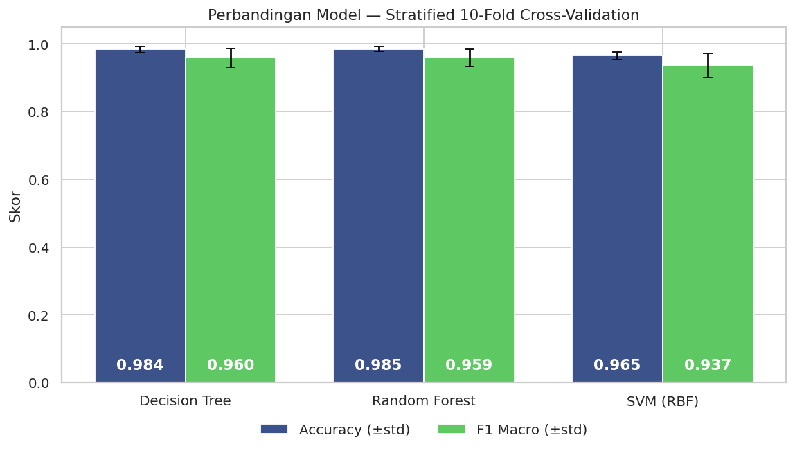

# 🚗 Car Evaluation — Klasifikasi Kualitas Mobil

Membandingkan tiga algoritma *machine learning* (Decision Tree, Random Forest, SVM) untuk memprediksi
tingkat **penerimaan (acceptability)** sebuah mobil dari enam atribut kategorikal.

**Dataset:** [Car Evaluation — UCI Machine Learning Repository](https://archive.ics.uci.edu/dataset/19/car+evaluation)
(1.728 baris, 6 fitur, 4 kelas: `unacc`, `acc`, `good`, `vgood`). Lisensi dataset: CC BY 4.0.

| Fitur | Nilai |
|---|---|
| `buying` | low, med, high, vhigh |
| `maint` | low, med, high, vhigh |
| `doors` | 2, 3, 4, 5more |
| `persons` | 2, 4, more |
| `lug_boot` | small, med, big |
| `safety` | low, med, high |

## Hasil

Evaluasi dengan stratified 10-fold cross-validation pada seluruh data:

| Model | Accuracy | F1 Macro |
|---|---|---|
| Decision Tree | 0,984 ± 0,009 | 0,960 ± 0,028 |
| Random Forest | 0,985 ± 0,007 | 0,959 ± 0,026 |
| SVM (RBF, default) | 0,965 ± 0,011 | 0,937 ± 0,036 |



**Temuan utama**
- `persons` dan `safety` adalah fitur terpenting. `safety = low` atau `persons = 2` selalu menghasilkan `unacc`.
- Decision Tree dan Random Forest **setara**; selisihnya jauh di bawah simpangan baku antar fold.
- SVM (parameter default, belum dituning) sedikit tertinggal, terutama pada recall kelas `good`.
- Kelas `good` dan `vgood` sangat sedikit (69 dan 65 baris), jadi F1 macro dan laporan per kelas lebih informatif
  daripada accuracy global.

> **Catatan:** dataset ini dibuat dari kombinasi penuh semua atribut dengan aturan keputusan deterministik,
> sehingga skor tinggi tidak otomatis berarti performa yang sama pada data dunia nyata. Hasil ini sebaiknya
> dibaca sebagai perbandingan antar-algoritma.

## Isi Notebook

1. Eksplorasi data (EDA)
2. Pra-pemrosesan (`OrdinalEncoder` dengan urutan kategori eksplisit)
3. Pelatihan Decision Tree, Random Forest, dan SVM
4. Evaluasi: accuracy, precision, recall, F1 (weighted & macro), laporan per kelas
5. Stratified 10-fold cross-validation
6. Confusion matrix dan feature importance
7. Kesimpulan

## Struktur Repo

```
.
├── car_evaluation.ipynb
├── model_comparison.png
├── requirements.txt
└── README.md
```

## Pengembangan Selanjutnya

- Hyperparameter tuning (`GridSearchCV`), terutama `C` dan `gamma` pada SVM.
- Penanganan ketidakseimbangan kelas (`class_weight='balanced'`, SMOTE).
- Model tambahan: Gradient Boosting / XGBoost.

## Sumber Data

Bohanec, M. (1997). *Car Evaluation* [Dataset]. UCI Machine Learning Repository.
https://doi.org/10.24432/C5JP48
